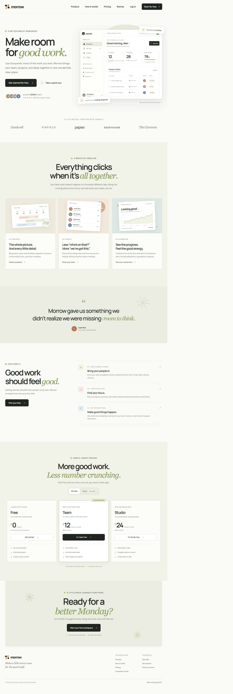

# Morrow

A polished, responsive landing page for Morrow, a calmer home for collaborative work. Built with plain HTML, CSS, and JavaScript—no frameworks, build tools, or package installation required.

## Preview



## Run locally

Open `index.html` in a browser, or serve the project with any static web server. For example, with Python installed:

```bash
python -m http.server 8000
```

Then visit [http://localhost:8000](http://localhost:8000).

## Project files

- `index.html` — accessible page structure and content.
- `styles.css` — page styling, responsive layouts, and dashboard illustrations.
- `script.js` — mobile navigation, interactive monthly/yearly pricing, and current-year display.
- `screenshots/landing-page.png` — full-page desktop screenshot.

## Features

- Responsive desktop and mobile layouts with an accessible mobile navigation menu.
- Three pricing plans with an accessible monthly/yearly billing toggle and annual savings.
- A custom workspace preview and product illustrations made entirely with HTML and CSS.
- Semantic landmarks, descriptive page metadata, and reduced-motion support.
- A Google Fonts connection for DM Sans and Manrope, with system font fallbacks.
